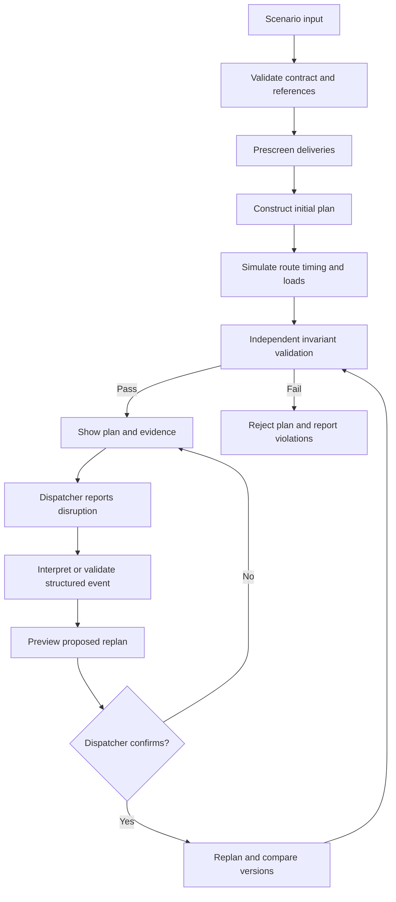
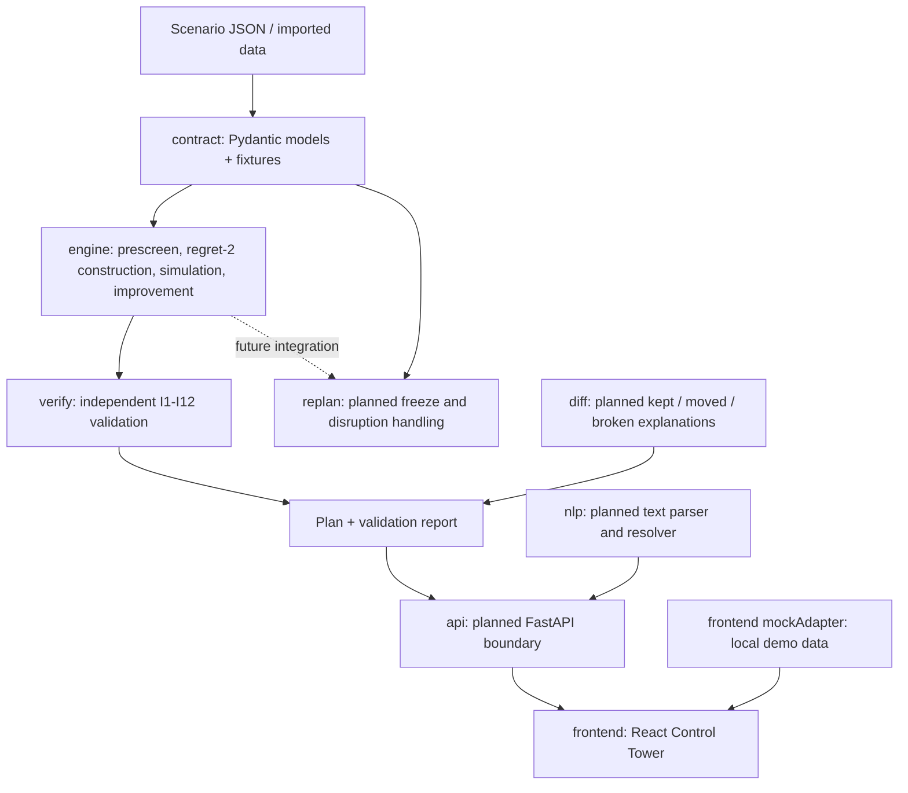

# ReRoute

**Disruption-aware delivery planning with an explainable plan and independent
validation.**

ReRoute is a work-in-progress decision-support project for vehicle routing. Its
design goal is to build an initial delivery plan from a depot, vehicles, delivery
demands, hard service windows, and a travel-time matrix; then help a dispatcher
evaluate changes after a road closure, vehicle failure, or urgent delivery.

The project is deliberately matrix-only: it does not require live maps, GPS, tile
services, or network routing. The dispatcher-centered target flow is
**propose → preview → confirm**. A plan should be independently checked before it is
accepted, and every delivery change should have an explanation.

> [!IMPORTANT]
> **This checkout is not a production-ready end-to-end application.** The initial
> planning engine, contract models, independent validator, and offline frontend are
> present. However, diff classification/explanation, the FastAPI application and
> route files, disruption replanning modules, NLP interpreter modules, command-line
> entry point, and OpenAPI generation script are empty. The frontend currently runs
> against a deterministic local mock adapter; it does **not** call the Python engine
> or a live API. See
> [Implementation status](#implementation-status) before using this project.

## Contents

- [What ReRoute does](#what-reroute-does)
- [Current workflow and architecture](#current-workflow-and-architecture)
- [Implementation status](#implementation-status)
- [Technology](#technology)
- [Repository map](#repository-map)
- [Requirements](#requirements)
- [Getting started](#getting-started)
- [Commands](#commands)
- [Data and scenario format](#data-and-scenario-format)
- [Contracts and invariants](#contracts-and-invariants)
- [Testing and CI](#testing-and-ci)
- [Configuration](#configuration)
- [Frontend](#frontend)
- [Limitations and production-readiness checklist](#limitations-and-production-readiness-checklist)
- [Contributing](#contributing)
- [License](#license)

## What ReRoute does

The product is designed to:

1. Assign deliveries to vehicles and sequence their stops.
2. Respect vehicle capacity, shift limits, delivery service times, and hard
   time-window constraints.
3. Calculate arrival, waiting, service-start, and departure times from the supplied
   travel-time matrix.
4. Keep infeasible deliveries visible with a reason rather than silently dropping
   them.
5. Replan a mutable portion of routes following operational disruptions.
6. Show a dispatcher what changed, why it changed, and what still needs a decision.
7. Gate accepted plans through an independent validator.

The implemented backend foundation is an initial-plan engine: prescreening,
deterministic regret-2 insertion, route simulation, feasibility diagnostics, and
bounded improvement. An independent validator is also present. The UI is a separate
offline demonstration and should not be treated as a control surface for that backend
yet.

## Current workflow and architecture

### Target operational workflow



The target disruption types are:

- **Road closure:** adjust the stated direct matrix edge for departures during the
  specified interval. The model does not infer detours.
- **Vehicle failure:** freeze completed/in-progress work and transfer remaining
  work according to the configured policy.
- **Urgent delivery:** add a delivery during the planning horizon and evaluate
  insertion into a route.

For free text, the intended flow is exact entity resolution, visible parsed fields
and assumptions, preview, and explicit dispatcher confirmation. Unknown or ambiguous
locations and vehicles must be rejected rather than fuzzy-matched.

### Code structure



**Implemented versus intended:** the graph describes the architecture target.
`api/`, `replan/`, `nlp/`, `diff/`, data generator/importer modules, and benchmark
modules currently contain placeholder/empty modules. The
React app obtains its data from `frontend/src/api/mockAdapter.ts`, not from a running
FastAPI service.

## Implementation status

| Area | Current state |
|---|---|
| Contract | Pydantic v2 models and JSON fixtures are present. Contract versioning rules are documented. |
| Initial planning | Prescreening, deterministic regret-2 insertion, simulation, diagnostics, objective scoring, and bounded improvement are implemented under `engine/`. |
| Independent validation | `verify/` recomputes core plan invariants without importing the engine simulator. |
| Diff | **Not implemented in this checkout.** `diff/classify.py` and `diff/explain.py` are empty. |
| Scenario data | Example scenario JSON files are present under `data/scenarios/`. Generator/importer modules are placeholders and empty. |
| Replanning | **Not implemented in this checkout.** Python modules under `replan/` are empty. |
| Natural-language input | **Not implemented in this checkout.** Python modules under `nlp/` are empty. |
| HTTP API | **Not implemented in this checkout.** `api/main.py` and route modules are empty; there is no working API server or OpenAPI document. |
| Frontend | React/Vite dashboard with an offline mock adapter, seeded Pune-inspired schematic simulation, baseline/impossible/stress mock scenarios, schedule, fleet, and disruption preview UI. The frontend does not call the backend. |
| CLI and demo command | **Not implemented.** `scripts/cli.py`, demo helpers, and `make demo` are placeholders. |
| Benchmarks | **Not implemented.** Benchmark files under `engine/benchmarks/` are empty. |
| Type generation | **Not implemented.** `scripts/gen_types.sh` and `frontend/src/api/schema.d.ts` are empty. |
| Deployment and operations | No production deployment, database, authentication, authorization, telemetry, or service-level configuration is included. |

UI elements labelled as validation, disruption, or simulation in mock mode are
illustrative fixtures. They are not evidence of a server-side plan, real-time
traffic, or production validation.

## Technology

| Layer | Technology | Purpose |
|---|---|---|
| Backend runtime | Python 3.12, managed with `uv` | Typed engine and project tooling |
| API framework | FastAPI, Uvicorn | Intended HTTP boundary; app wiring is not implemented yet |
| Data contracts | Pydantic v2 | Strict, immutable request/result models |
| Planning | Custom pure-Python heuristic | Explainable deterministic insertion and local improvement |
| Validation | pytest, Hypothesis, Ruff | Unit, acceptance, edge, property, formatting, and lint checks |
| Frontend | React 18, TypeScript, Vite, Tailwind CSS | Local dispatcher dashboard |
| Frontend state/data | Zustand, TanStack Query | UI state and adapter query boundary |
| Charts/map | SVG and `d3-scale` | Local schematic views; no tile/map SDK |
| Browser testing | Playwright | UI smoke and demo-path test definitions |
| Optional benchmark | OR-Tools | Optional comparison under `engine/benchmarks/` only |
| Optional text extraction | Anthropic SDK (optional dependency) | Intended opt-in extractor; NLP integration is not implemented |

The Python package metadata and lockfile are `pyproject.toml` and `uv.lock`.
Frontend package scripts and dependencies are in `frontend/package.json`. The
repository currently has no frontend lockfile checked in, so use the package manager
chosen by your team consistently before establishing a reproducible CI install.

## Repository map

```text
.
├── api/                    FastAPI app/routes/store placeholders (currently empty)
├── contract/               Pydantic models, signatures, JSON fixtures
├── data/
│   ├── scenarios/           Example baseline, closure, failure, urgent, stress inputs
│   ├── generators/          Placeholder (empty)
│   └── importers/           Placeholder (empty)
├── diff/                    Planned classification/explanation (empty modules)
├── docs/
│   ├── ARCHITECTURE.md      Intended component boundaries
│   ├── ASSUMPTIONS.md       D1-D10 assumptions and I1-I12 invariants
│   ├── REQUIREMENTS.md      R1-R15 requirement/test mapping
│   ├── SPEC.md              Project challenge/problem statement
│   ├── TECH_STACK.md        Stack rationale
│   └── pitch/               Demo and product narrative material
├── engine/                  Initial-plan construction, simulator, objective, diagnostics
│   └── benchmarks/          Planned optional solver comparisons (empty modules)
├── frontend/                React/Vite offline dashboard and UI test definitions
├── nlp/                     Natural-language module placeholders (currently empty)
├── replan/                  Replanning module placeholders (currently empty)
├── scripts/                 Test scoreboard and command placeholders
├── tests/
│   ├── unit/                Unit tests by module
│   ├── acceptance/          Requirement-level acceptance tests
│   ├── edge/                Disruption and boundary cases
│   └── property/            Hypothesis strategies and invariant fuzz tests
└── verify/                  Independent plan validator and report helpers
```

Additional project references:

- [`CLAUDE.md`](CLAUDE.md): coding conventions, lanes, commands, and constraints.
- [`docs/CONTRACT_CHANGES.md`](docs/CONTRACT_CHANGES.md): contract-change process.
- [`contract/README.md`](contract/README.md): model and fixture conventions.
- [`verify/README.md`](verify/README.md): validator independence and adversarial checks.
- [`tests/README.md`](tests/README.md): test markers, acceptance status, and fixture strategy.
- [`frontend/README.md`](frontend/README.md): frontend-specific run and check instructions.

## Requirements

Project requirements are tracked as R1–R15 in [`docs/REQUIREMENTS.md`](docs/REQUIREMENTS.md).
They cover initial assignment, capacity and timing, explainability, the three
disruption types, text interpretation and confirmation, unknown-reference rejection,
and plan comparisons with reasons.

The core modeling rules are D1–D10, and the validation gate is defined by I1–I12 in
[`docs/ASSUMPTIONS.md`](docs/ASSUMPTIONS.md). These are project design constraints,
not a statement that every requirement is already implemented.

## Getting started

### Prerequisites

- Python **3.12** (the project explicitly requires `<3.13`).
- [`uv`](https://docs.astral.sh/uv/) for the Python environment and commands.
- Node.js LTS and npm for the frontend. pnpm 9 is used by the current GitHub Actions
  workflow and is conditionally used by the Makefile if it is installed.
- Git.

### Install Python dependencies

From the repository root:

```sh
uv sync
```

To install optional development integrations:

```sh
uv sync --extra bench
uv sync --extra llm
```

OR-Tools and Anthropic are optional dependencies. Their code paths should not be
assumed usable merely because the package is installed; the benchmark/text features
are incomplete in this checkout.

### Install and run the frontend mock

```sh
cd frontend
npm install
npm run dev
```

Open <http://localhost:5173>. The frontend uses deterministic local data and does not
need API credentials or a backend process.

### Backend/API note

The intended development API command is `make dev` (Uvicorn at
`api.main:app`), but it is **not currently runnable** because `api/main.py` is empty.
Likewise, there is no supported CLI command for generating or replanning scenarios.
Use the implemented Python modules directly from tests or Python code; use the UI
only as an offline mock.

## Commands

Run commands from the repository root unless noted.

| Command | Purpose | Current caveat |
|---|---|---|
| `uv sync` | Install locked Python dependencies | Supported |
| `make setup` | Sync Python; conditionally install frontend dependencies if pnpm exists | Does not install frontend dependencies with npm |
| `make check` | Ruff lint/format check, fast pytest suite, and conditional frontend TypeScript/build check | Frontend check runs only when pnpm is installed |
| `uv run pytest -q` | Run the Python test suite | Some acceptance tests may be expected failures while features are unfinished |
| `uv run pytest -q -m acceptance` | Run acceptance-marked tests | Check xfail/XPASS output |
| `uv run pytest -q -m edge` | Run edge tests | — |
| `uv run pytest -q -m property` | Run property tests | — |
| `uv run pytest -q -m slow` | Run slow/fuzz tests | Can take longer; bounded by test settings |
| `uv run ruff check .` | Lint Python files | — |
| `uv run ruff format --check .` | Verify Python formatting | — |
| `cd frontend && npm run dev` | Start offline React/Vite app | Does not start API |
| `cd frontend && npm run typecheck` | Type-check frontend | — |
| `cd frontend && npm test` | Run Vitest tests | Covers current offline simulation |
| `cd frontend && npm run build` | Build frontend bundle | — |
| `cd frontend && npm run e2e` | Run Playwright browser tests | Install the matching Playwright browser first |
| `make types` | Intended OpenAPI TypeScript generation | Not operational: generator script and schema are empty |
| `make demo` | Intended full product demo | Not implemented; currently prints `not built yet` |
| `make dev` | Intended FastAPI development server | Not operational until `api.main:app` is implemented |

For Playwright, install the browser matching the installed Playwright package when
needed:

```sh
cd frontend
npx playwright install chromium
```

This downloads a browser binary; it is only needed for browser tests, not for the
frontend build or unit tests.

## Data and scenario format

### Upload schedule

The header's **Upload schedule** flow supports either scenario inputs or an
existing schedule. Scenario inputs may be one JSON file, four CSV files
(`locations`, `vehicles`, `deliveries`, and a square `matrix`), or a ZIP
containing those CSVs. Existing schedules are CSV or JSON rows with
`vehicle_id`, `sequence`, `stop_type`, and `delivery_id`, plus optional
`planned_arrival`. Uploaded times are never trusted: the simulator recomputes
arrival, wait, service start, departure, and load before validation.

Times accept integer minutes, `HH:MM`, or `H:MM am/pm`. UTF-8 BOM and comma or
semicolon CSV are supported. Files are limited to 5 MB; ZIP content is limited
to 20 MB uncompressed and path traversal entries are rejected. Scenarios above
200 deliveries or 15 vehicles receive a warning but remain usable. A missing
matrix can be derived from x/y coordinates using the documented 30 km/h speed
assumption, rounded up; this assumption is shown during review. Uploads are
previewed before confirmation, so rejected uploads leave the current session
unchanged. Downloadable micro-scenario templates are available at
`/templates/{scenario_json,locations_csv,vehicles_csv,deliveries_csv,matrix_csv,schedule_csv}`.

Example JSON scenarios live in [`data/scenarios/`](data/scenarios/):

- `baseline.json` — initial planning walkthrough.
- `closure.json` — road-closure input.
- `failure.json` — vehicle-failure input.
- `urgent.json` — urgent delivery input.
- `impossible.json` — infeasible demand/window example.
- `stress.json` and `cascade.json` — larger or multi-event examples.

Contract fixtures in [`contract/fixtures/`](contract/fixtures/) provide a smaller
hand-checkable micro scenario, plans, disruption examples, proposal examples,
validation reports, and diff results. `MICRO_WALKTHROUGH.md` shows the intended
arithmetic.

At a high level, a scenario contains:

- Unique locations and one depot reference.
- Vehicles with a start location, capacity, and optional shift end.
- Deliveries with location, demand, service time, priority, and hard time window.
- A square travel-time matrix indexed in the same order as the locations array.
- Current/start times, transfer configuration, and a deterministic seed.

Times are integer minutes since midnight; matrix values are integer minutes.
Pydantic contract models reject extra fields and are immutable after validation.
Refer to [`contract/models.py`](contract/models.py) for authoritative fields and
validation rules. Do not hand-edit generated OpenAPI types.

JSON scenario examples are checked in, but data generation, CSV/JSON importer
functions, and a scenario-upload HTTP flow are not implemented yet.

## Contracts and invariants

The contract package is the intended shared source of truth for the engine,
replanner, API, NLP layer, fixtures, and frontend. After the contract freeze, changes
are additive-only and should be recorded in [`docs/CONTRACT_CHANGES.md`](docs/CONTRACT_CHANGES.md).

Important invariant groups include:

- **Accounting:** every delivery is placed once or has an explicit unplaced reason.
- **Capacity:** load remains valid at route start and after pickups/deliveries.
- **Timing:** windows constrain service start; early arrivals wait explicitly.
- **Travel:** use matrix entries and the documented closure timing rule.
- **Replanning:** preserve frozen work and remove assignments from failed vehicles.
- **Explainability:** moved/broken work has a cause; unknown references are not guessed.
- **Determinism:** same input and seed produce the same result.
- **Confirmation:** interpreted text must not be applied without explicit approval.

The `verify/` package is designed to recalculate important checks independently of
the engine simulator. It must remain independent as the engine evolves.

## Testing and CI

Python tests are grouped into:

- `tests/unit/` — contracts and individual modules.
- `tests/acceptance/` — requirement-oriented behavior (R1–R15).
- `tests/edge/` — edge/disruption cases.
- `tests/property/` — generated scenarios and invariant checks.

Pytest markers are configured in `pyproject.toml`: `acceptance`, `edge`, `property`,
and `slow`. `make check` excludes `slow` tests by default. Consult
[`tests/README.md`](tests/README.md) for expected-failure handling: when an xfailed
test begins passing, review it and remove the xfail marker so it counts as a regular
pass.

Frontend unit tests use Vitest; browser workflow tests are under `frontend/e2e/` and
use Playwright.

GitHub Actions (`.github/workflows/ci.yml`) runs on pushes to `main` and pull
requests. It provisions Python 3.12, uv, Node LTS, and pnpm 9, then runs `make setup`
and `make check`.

**A passing test suite is not equivalent to production readiness.** The API,
replanning, and NLP integration are incomplete, and the UI uses mock validation.
Always inspect xfail/XPASS counts and run the tests relevant to a change.

## Configuration

`.env.example` lists intended environment variables:

| Variable | Example/default | Intended purpose | Current status |
|---|---|---|---|
| `REROUTE_MOCK_MODE` | `false` | Select mock versus API mode | Frontend currently always uses its mock adapter |
| `REROUTE_TRANSFER_MINUTES` | `10` | Default parcel transfer duration | Present in configuration template; API not wired |
| `REROUTE_LLM_ENABLED` | `false` | Explicitly opt into optional extraction | NLP module is not implemented |
| `ANTHROPIC_API_KEY` | empty | Credential for optional extractor | Not required for or used by the current UI |
| `REROUTE_LLM_MODEL` | empty | Optional extractor model | Not wired |
| `REROUTE_LLM_TIMEOUT_S` | `3` | Intended extractor timeout | Not wired |

Do not commit `.env` files, credentials, customer data, or production secrets. No
secret is needed to run the offline frontend.

## Frontend

The frontend is a local control-tower prototype featuring:

- A seeded, illustrative Pune-inspired street schematic with named reference
  destinations; it is not to scale and is not a navigation map.
- Animated vehicle markers and route paths in the local mock simulation.
- Baseline, impossible-delivery, and stress mock scenarios.
- Fleet status, Gantt schedule, waiting visualization, load profile, stop table,
  KPIs, and unplaced-delivery explanation.
- Mock disruption previews and verification display.

No map tiles, map SDK, CDN font, GPS feed, live traffic, or external API request is
used by the current frontend. The mock adapter is isolated in
[`frontend/src/api/mockAdapter.ts`](frontend/src/api/mockAdapter.ts); API replacement
requires a working backend contract and implementation.

See [`frontend/docs/pitch/DESIGN.md`](frontend/docs/pitch/DESIGN.md) for the visual
direction and [`frontend/docs/CONTRACT.md`](frontend/docs/CONTRACT.md) for the UI
adapter notes.

## Limitations and production-readiness checklist

### Model and solver limits

The model is intentionally bounded: one depot, one capacity dimension, no split
parcels, hard service windows, matrix travel times, and direct-edge closure changes.
Vehicles are treated as committed to their next stop while in transit. The heuristic
has no general optimality guarantee. See the locked assumptions in
[`docs/ASSUMPTIONS.md`](docs/ASSUMPTIONS.md).

### Before any operational deployment

- [ ] Implement and integration-test the API routes and app lifecycle.
- [ ] Implement closure, vehicle-failure, urgent-delivery, freeze/snapshot, and
  repeated-replan behavior.
- [ ] Implement exact-match text parsing/resolution and enforce the
  propose/preview/confirm gate server-side.
- [ ] Wire the frontend to typed API responses; remove mock success paths from
  production builds.
- [ ] Validate plans server-side before persistence or dispatch; preserve audit
  history and explainability.
- [ ] Add authentication, authorization, tenant isolation, input/rate limits, and
  secret management appropriate to the deployment.
- [ ] Decide persistence, backup/recovery, concurrency, idempotency, and retention
  policies; the current API store is not implemented.
- [ ] Add structured logs, metrics, tracing, health/readiness checks, alerting, and
  operational runbooks.
- [ ] Define deployment configuration, supported environments, data-protection
  requirements, threat model, and disaster-recovery objectives.
- [ ] Validate data import and matrix provenance with real operational datasets; the
  Pune frontend scene is illustrative only.
- [ ] Establish performance/load tests and publish measured solver/runtime limits.
- [ ] Complete browser E2E validation and an accessibility review.

## Contributing

Before changing core behavior:

1. Read [`CLAUDE.md`](CLAUDE.md), [`docs/ASSUMPTIONS.md`](docs/ASSUMPTIONS.md),
   [`docs/REQUIREMENTS.md`](docs/REQUIREMENTS.md), and
   [`docs/TECH_STACK.md`](docs/TECH_STACK.md).
2. Keep the contract additive after freeze; document approved changes.
3. Preserve determinism, invariant checks, and validator independence.
4. Add or update tests tied to the affected requirement/invariant.
5. Run the smallest relevant test first, then `make check` when the environment
   supports it.
6. Do not introduce map tiles, remote fonts, fuzzy entity matching, or hidden
   solver wall-clock cutoffs.

The single-writer work lanes and further contribution conventions are in
[`CLAUDE.md`](CLAUDE.md).

## License

This project is distributed under the MIT License. See [`LICENSE`](LICENSE).
